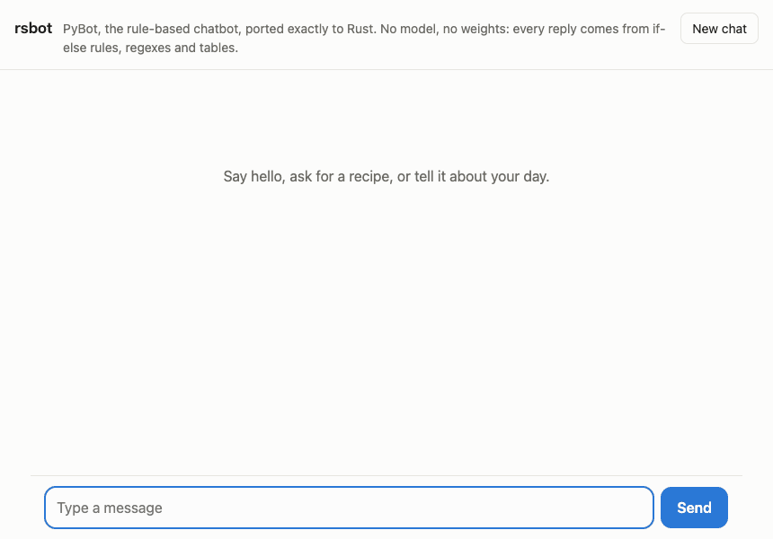
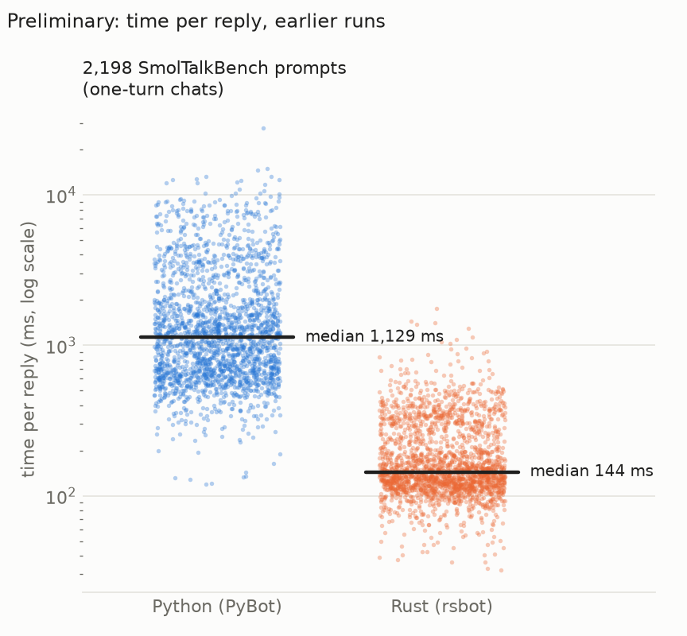

# rsbot: PyBot in Rust



*The same four-turn conversation in PyBot's terminal and in rsbot's web chat. The replies match
word for word, including the name remembered in the last turn.*

rsbot is an exact port of [PyBot](https://github.com/huggingface/pybot) to Rust, written by
Claude Code agents. PyBot is a rule-based chatbot (if-else branches, regexes and lookup tables;
no weights) that agents wrote in about 640k lines of Python. Its authors report a 26% win rate
on SmolTalkBench. rsbot aims to give the same reply and keep the same conversation memory as
PyBot on every turn, in readable Rust.

**Status: complete.** Every PyBot function is ported, and every recorded turn matches PyBot.

## Results

### Correctness

All checks compare rsbot with PyBot (commit 24cbc0439e07), with the date pinned to 2026-11-17
and the same random seed. The reference ("oracle") was recorded by running PyBot on four sets:

| Set | Source | Size |
|---|---|---|
| single | SmolTalkBench prompts (1,000 gold + 1,198 held-out) | 2,198 one-turn chats |
| conversations | smoltalk everyday-conversations | 2,379 chats, 9,348 turns |
| synthetic | written to reach all 8,081 knowledge-base entries | 3,000 chats, 9,000 turns |
| extra | smol-magpie-ultra, systemchats-30k, openhermes-100k | 4,500 chats, 10,494 turns |

**Turn by turn** (`turn_check`): each of the 116 stages of a turn (16 observers, 97 responders,
2 after-hooks, the arbiter) gets PyBot's exact memory and RNG state, and its reply and memory
changes must equal PyBot's.

**End to end** (`turn_check --e2e`): each conversation runs in rsbot alone, carrying its own
memory; only the user's lines come from the recording.

| Set | Stage checks identical | Replies identical end to end |
|---|---|---|
| single | 254,518 / 254,518 | 2,198 / 2,198 |
| conversations | 1,082,696 / 1,082,696 | 9,348 / 9,348 |
| synthetic | 1,042,045 / 1,042,045 | 9,000 / 9,000 |
| extra | 1,214,371 / 1,214,371 | not run |

Lower-level checks also show 0 differences: regexes (10,024 / 10,024, `regex_check`), CPython's
`random` (304 / 304 seeds), the reading of each benchmark prompt (2,198 / 2,198,
`oracle_check`), knowledge-entry guards and replies (916,598 calls, `entry_check`), and several
million recorded PyBot function calls (`src/bin/*_check.rs`).

### SmolTalkBench win rate

rsbot's replies equal PyBot's on all 2,198 prompts, so one judging covers both. Judged by
Claude Haiku 5.5 (`harness/judge_claude.py`: AlpacaEval 2.0's annotator prompt, WildBench's
length penalty, each prompt judged in both orders):

| Split | Prompts | Win rate (both orders) | AlpacaEval order only |
|---|---|---|---|
| gold | 1,000 | 27.4% | 27.1% |
| held-out | 1,198 | 24.9% | 25.1% |
| **all** | **2,198** | **26.0%** | **26.0%** |

The order of the two replies changed the verdict on 120 prompts. The run cost $0.18 (Message
Batches API, effort low). The published 26% used a different judge (DeepSeek-V4.1-Flash, read
through token probabilities), so the two figures are comparable but not computed the same way.
The claim that PyBot is "on par with SmolLM-360M-Instruct" was not re-measured.

### Speed and memory

**Preliminary.** A controlled benchmark is running and will replace these numbers.



| | PyBot | rsbot |
|---|---|---|
| median time per reply (2,198 prompts) | 1,129 ms | 144 ms (7.8x faster) |
| 90th percentile | 4,364 ms | 382 ms (11.4x faster) |
| startup plus one reply (release build) | 3.06 s | 0.87 s |
| peak memory (one prompt) | 180 MB | 904 MB |

These runs were not controlled: PyBot ran with 10 workers on a busy machine, and rsbot used the
development build while other checks ran. rsbot uses more memory because it loads all 47 MB of
PyBot's exported JSON at start, while Python imports only what it needs; this can be fixed
without changing any reply.

The controlled run (`harness/run_bench.sh`, plotted by `harness/plot_speed.py`) uses the release
build, the same inputs, date and seed on both sides, one process each, on an idle 12-core Apple
Silicon Mac with 32 GB. It covers all 2,198 prompts and the first 500 conversations (1,960
turns), records wall-clock time, CPU time and peak memory with `/usr/bin/time -l`, and times each
reply. Replies are compared first and must be identical.

## Web chat

```sh
cargo build --release --bin rsbot_web
./target/release/rsbot_web --port 8790      # then open http://127.0.0.1:8790/
```

- Each browser tab is its own conversation, with its own memory and random generator, so it
  answers as `pybot.py` would. "New chat" starts over.
- Each reply shows the module that answered and the time it took.
- API: `POST /api/chat` takes `{"session", "text"}` and returns `{"reply", "module", "ms",
  "turn"}`; `POST /api/reset` forgets a conversation; `GET /api/health` reports status.
- Every turn is logged as a JSON line to `logs/rsbot-YYYY-MM-DD.jsonl` (UTC days). Change the
  folder with `--log-dir DIR` or turn logging off with `--no-log`. The logs hold what people
  type, so keep them private; `logs/` is in `.gitignore`.
- It uses only the standard library and serves one request at a time. It is meant for local
  use; use `--host 0.0.0.0` behind your own proxy to reach it from other machines.

`harness/web_test.mjs` drives the page in Chrome (`puppeteer-core`) and checks replies, memory,
"New chat", separate tabs, Shift+Enter, empty lines, dark mode, phone width and page errors. All
14 checks pass, and a five-turn conversation matched PyBot.

## In the browser (WebAssembly)

`wasm/` builds rsbot to WebAssembly with a static page that runs the bot in the browser, with no
server: https://hyunhwan-bcm.github.io/rsbot/. Nothing typed into it leaves the page.

- The page downloads the bot (`rsbot.wasm.gz`, 8.1 MB) and PyBot's data (`bundle.json.gz`,
  9.5 MB) once.
- The bot runs in a Web Worker holding one conversation, seeded with 0 as in `rsbot_web`.
- The date comes from the browser's clock and time zone.
- It needs WebAssembly exception handling (Chrome 95, Firefox 100, Safari 15.2 or later) and
  about 0.5 GB of memory. It has not been tried on a phone.

Build notes:
- Target `wasm32-wasip1`. A cdylib (`wasm/src/lib.rs`) exports `rsbot_load`, `rsbot_reset` and
  `rsbot_turn`; `wasm/web/wasi.js` is a minimal WASI host with no file system.
- A panic stands for a Python exception, so the runtime must catch it. The prebuilt WebAssembly
  `std` aborts on panic, so `wasm/.cargo/config.toml` rebuilds it with `panic=unwind` and
  WebAssembly exception handling. This needs nightly.
- PCRE2 is compiled with wasi-sdk. Its JIT has no WebAssembly backend, so `wasm/pcre2-nojit.h`
  turns it off and the interpreter runs the same patterns.
- Library changes: `data::supply` accepts the bundle's bytes, and in WebAssembly `py::clock`
  takes the time zone offset from the page. Native builds are unchanged.

`wasm/e2e.mjs` runs the module in Node, like `turn_check --e2e`. Replies match PyBot on single
(2,198 / 2,198), conversations (9,348 / 9,348) and synthetic (9,000 / 9,000). The deployed module
is the one checked: `wasm/strip.mjs` removes only debug names. `wasm/web_test.mjs` drives the
built page in Chrome; all 13 checks pass, including, with `RSBOT_BIN`, a six-turn conversation
identical to the native bot's.

Measured during those checks, with seven Node processes running at once: 0.21 s per reply for
synthetic, 0.38 s for conversations, 0.44 s for single; about 470 MB peak memory (904 MB
native). In Chrome, loading takes about a second, and the first reply is slower because regexes
compile on first use.

```sh
rustup toolchain install nightly --profile minimal --component rust-src --target wasm32-wasip1
# wasi-sdk: https://github.com/WebAssembly/wasi-sdk/releases (unpack anywhere)
WASI_SDK=/path/to/wasi-sdk wasm/build.sh               # -> wasm/dist/, about 2 minutes
node wasm/e2e.mjs ../data/export/turn_oracle/conversations.jsonl.gz    # check against PyBot
(cd wasm/dist && python3 -m http.server 8791)          # try it at http://127.0.0.1:8791/
rsync -a --delete wasm/dist/ ../hyunhwan-bcm.github.io/rsbot/          # then commit and push there
```

## How it was done

Claude Code agents wrote the port between 2026-11-17 and 2026-11-18, coordinated from one
session. Much of the two days went to waiting for usage limits to reset.

1. **Measure.** Run PyBot over the benchmark and real conversations, recording line coverage
   and the types of every argument and return value (`harness/trace_full.py`). PyBot's
   module-level data (~233k lines: word lists, reply pools, 10k regexes, 8,081 knowledge
   entries) is exported to a JSON bundle (`harness/export_data.py`) instead of retyped.
2. **Build the foundation.** Regex via PCRE2 (checked on all 10,024 patterns), CPython's
   Mersenne Twister, Python `str` semantics, a Python-like `Value` for the data, the
   conversation `Memory` and the runtime loop.
3. **Generate a skeleton** (`harness/gen_skeleton.py`): one typed Rust stub for each of the
   ~10,800 Python functions, with signatures from the recorded types and from a call-graph
   analysis of which functions write to memory. Workstreams could call each other's functions
   before they were ported; an unported stub panics, which the runtime treats as a Python
   exception.
4. **Port in parallel.** 23 workstreams, each in its own git worktree: understanding (U),
   knowledge base (D1, D2, KNO), memory (MEM1-8), compose (COM1-5) and modules (MOD1-4). Each
   checked its functions against recorded PyBot calls. The coordinator merged branches and kept
   `main` building.
5. **Fix the differences.** Once nothing was unported, 277 turns across 7 modules still
   differed. Two fix workstreams traced them to results dropped by unit-typed stubs, Python's
   shallow `dict(memory)` copies, entry replies writing to live memory, one private entry copy
   and one checker bug.
6. **Check end to end**, then benchmark and judge.

The oracles come from PyBot itself: `harness/turn_oracle.py` records every stage of every turn
(read by `turn_check`), `harness/entry_calls.py` every knowledge-entry call (`entry_check`),
`harness/oracle_dump.py` per-stage results on SmolTalkBench (`oracle_check`), and
`harness/pycall.py` runs any PyBot function on any input. PyBot runs only 42% of its statements
on real conversations, so the branches the corpus never reaches were ported by reading.
[PORTING.md](PORTING.md) has the conventions every workstream follows, and
[docs/session-prompts.md](docs/session-prompts.md) has the user's prompts up to the merge of
PR #1 (an API key removed, screened for slurs).

### What it cost

Estimated from the session transcripts' token counts at Anthropic API list prices:

| Who | Model | Output | Cache write | Cache read | Cost |
|---|---|---|---|---|---|
| 25 workstream agents | Claude Opus 5.5 | 10.5M | 39.4M | 2,952M | $1,115 |
| 25 workstream agents | Claude Fable 5.2 | 1.0M | 8.4M | 190M | $211 |
| coordinating session | Claude Opus 5.5 | 0.5M | 4.8M | 123M | $72 |
| coordinating session | Claude Fable 5.2 | 0.03M | 0.2M | 7M | $6 |
| SmolTalkBench judging | Claude Haiku 5.5 (batch) | 0.23M | - | - | $0.18 |
| **total** | | **12.2M** | **52.8M** | **3,272M** | **about $1,400** |

Prices: Opus 5.5 at $4 / $20 per million input / output tokens, Fable 5.2 at $8 / $40, cache
reads at $0.20, cache writes at the 1-hour rate (2x input). Cache reads dominate the count
because each agent turn re-reads its conversation, but they are cheap. At the 5-minute
cache-write rate the total is about $1,220. The work ran on a Claude subscription, so this is
the equivalent API price, not a bill.

## Layout

```
src/py/          Python behaviour: re (PCRE2), random (CPython MT19937), str methods
src/data.rs      the exported data bundle, as Python-like values
src/understood.rs, src/state.rs   the typed reading and the conversation memory
src/runtime.rs   one turn: observers, modules, arbiter, after-hooks (bot/runtime.py)
src/<package>/   bot/<package>/<file>.py -> src/<package>/<file>.rs
src/bin/         rsbot (CLI, same options as pybot.py), oracle_check, turn_check, entry_check, ...
harness/         Python side: exports, oracles, tracers, skeleton generator, benchmarks
wasm/            the bot as WebAssembly, and the static page that runs it in a browser
```

## How to run it

You need Rust 1.85 or later (edition 2024), Python 3.12, and PyBot's exported data bundle.

**1. Set up.** rsbot reads the bundle from `../data/export/bundle.json`, or from
`RSBOT_DATA=/path/to/bundle.json`.

```sh
mkdir work && cd work
git clone https://github.com/hyunhwan-bcm/rsbot rsbot && ln -s rsbot/harness harness
git clone https://github.com/huggingface/pybot upstream/pybot
git -C upstream/pybot checkout 24cbc0439e07fd015c0747ab3be6e782a42b5c5b
python3 harness/export_data.py data/export/bundle.json   # about 47 MB
cd rsbot && cargo build --release                         # about 2 minutes
```

**2. Chat.** The options match `pybot.py`'s.

```sh
./target/release/rsbot                      # interactive (/reset starts over, /exit quits)
./target/release/rsbot -p "how do I boil an egg?"   # one reply, then exit
./target/release/rsbot -v -p "hello"        # also show the module and the time
echo "hi there" | ./target/release/rsbot    # one reply per stdin line
./target/release/rsbot -s 42                # another seed (default 0, as in PyBot)
```

**3. Run a JSONL file.** Each row is a fresh conversation: `"instruction"` is one turn,
`"turns": [...]` is a multi-turn conversation. The output has one JSON line per row with the
replies, the module and the time per reply in ms.

```sh
./target/release/rsbot --jsonl ../data/smoltalkbench/all.jsonl replies.jsonl
```

**4. Pin the date.** Some replies depend on today's date. Set `RSBOT_TODAY=2026-11-17`, the date
the oracles were recorded, to reproduce PyBot's recorded replies.

**5. Check against PyBot.** Build the checkers with `cargo build --profile fast`.

```sh
export RSBOT_TODAY=2026-11-17
./target/fast/oracle_check understood gold        # how the bot reads each benchmark prompt
./target/fast/entry_check gold                    # knowledge-entry guards and replies
./target/fast/turn_check ../data/export/turn_oracle/conversations.jsonl.gz          # turn by turn
./target/fast/turn_check ../data/export/turn_oracle/conversations.jsonl.gz --e2e    # end to end
```

`harness/turn_oracle.py`'s docstring shows how to record the turn oracles.

**6. Reproduce the benchmarks.** From the `work` folder:

```sh
python3 harness/run_python.py data/smoltalkbench/all.jsonl runs/py.jsonl --workers 1
RSBOT_TODAY=2026-11-17 rsbot/target/release/rsbot --jsonl data/smoltalkbench/all.jsonl runs/rs.jsonl
# win rate: a dry run prints the cost; --submit sends the batch (needs ANTHROPIC_API_KEY)
uv run --with anthropic python harness/judge_claude.py --bench data/smoltalkbench/all.jsonl \
    --replies runs/rs.jsonl --out runs/judge.jsonl --model claude-haiku-5-5 --effort low --submit
```

## License

Apache-2.0, as PyBot. See LICENSE and NOTICE.
